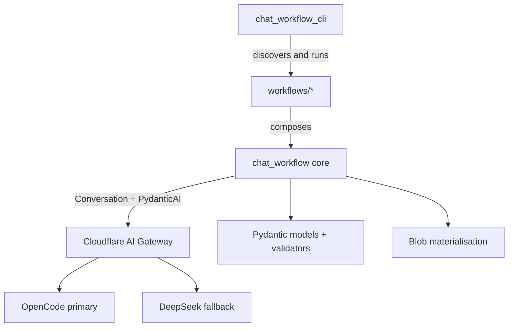

# TECHSPEC — chat-workflow

## Technology choices

| Choice | Why | Requirement |
|---|---|---|
| Python 3.12 | Current house runtime; typing and `match` support | R1–R7 |
| Pydantic v2 | Models are the contract: field descriptions feed the prompt, validators enforce business rules | R1, R3 |
| PydanticAI (`pydantic-ai-slim`) | One model path over an OpenAI-compatible gateway; the answer is a forced tool call, which the endpoint enforces | R5 |
| Typer | CLI discovery is a small surface with good help text | R2 |
| codegen / libcst | Workflow code generation and static verification | R2 |
| Cloudflare AI Gateway | Provider keys stay out of the app; OpenCode → DeepSeek failover; per-repo analytics | R5 |
| uv + ruff + pyrefly | Reproducible installs; lint and type gates that run in seconds | contributor workflow |

No spikes are open. The one deliberate deviation — `unittest` instead of
`pytest` — is recorded in [coding standards](coding-standards.md): the eval
harness needs module-level discovery and a timeout wrapper.

## Architecture

### Layer boundaries (enforced)

`tests/unit/test_architecture.py` asserts, with absolute path globs:

- `chat_workflow/` (the core) may not import `workflows/` or
  `chat_workflow_cli/`.
- `workflows/` may import the core; it may not import the CLI.
- `chat_workflow_cli/` is the composition root and may import both.

The architecture test encodes the layering as designed now; a deliberate
layering change updates the test in the same commit.

## Object model

| Concept | Owner | Contract |
|---|---|---|
| `Config` | `chat_workflow/config.py` | Reads `config.json`; resolves provider/model/api key env/api base |
| `Session` | `chat_workflow/session.py` | One conversation: IO, its own PydanticAI transcript, config, optional parent/children, `instructions`, `active`; `spawn` creates a clean child |
| `SessionComponent` | `chat_workflow/session_component.py` | Runs a session: `greet`, `converse(step)`, `present`, `sign_off`; stateless and usable at any depth |
| `AtomicWorkflow` | `chat_workflow/atomic_workflow.py` | One turn loop over a `Conversation`: intent, turn limit, the last-turn shape |
| `Conversation` | `chat_workflow/conversation.py` | The one model call: transcript, answer tool, transport/unusable/output budgets |
| `CompositeWorkflow` | `chat_workflow/decorators.py` | Calls atomic and composite children with the same `Session` |
| `AgentResponse` / `AgentIntent` | `chat_workflow/models.py` | A discriminated union: continue, success + value, or failure; the answer is a tool call |
| `LLMValidated` | `chat_workflow/mixins.py` | Runs `Validation(...)` rules through the model |
| `BlobSyncMixin` | `chat_workflow/mixins.py` | Materialises annotated fields to files after success |
| `Component` | `workflows/workflow/component.py` | The generated component: a class with a Pydantic model and workflow steps |
| `ComponentSourceCode` | `workflows/workflow/component_source_code.py` | The generated Python source for a component |
| `WorkflowSpec` | `workflows/workflow/workflow_spec.py` | The workflow spec: name, diagram, inputs, outputs, and component specs |
| `ComponentSpec` | `workflows/workflow/component_spec.py` | The component spec: name, purpose, scope, required inputs, type |

`WorkflowSpec` is the **workflow spec**, not a runtime workflow. A runtime workflow
is an atomic or composite workflow step. Further vocabulary:
[domain concepts](reference/domain-concepts.md).

## The model path

There is one path from the library to a model: `Conversation.send()` in
`chat_workflow/conversation.py`. A workflow step, the rule judge, and an eval's
user simulation are all conversations. Nothing else imports a provider SDK.

- The answer is a forced `answer` tool call (`ToolOutput(..., strict=True)`).
  `response_format` is not used: the endpoints behind this model accept it and
  ignore it; a tool's schema is enforced on the same route.
- The transcript is PydanticAI's message list — thinking, tool calls, tool
  returns, retry prompts and the final answer. `transcript.render` is the one
  projection into the audit view and the user view.
- Retry policy, one class per failure: transport failures are the provider
  SDK's resend; a response with no usable content is resampled invisibly; a
  rejected answer is a visible retry carrying the validator's own complaint; a
  tool failure is a tool result the model adapts to. `max_requests` bounds one
  turn's model steps.
- The last allowed turn offers `FinalResponse` (success or failure, no
  continue), so a step that has run out of turns cannot ask another question.

## Session and prompt architecture

There is one recursive `Session` concept. The top-level conversation and a
meeting spawned inside it are the same class:

- `parent`, `children`, `instructions`, `active` and `spawn` are the tree. A
  child gets the same user and config, a new `SessionLog`, and empty
  `state.messages`; the brief is passed as parameters to the child's step.
- `active` is the one flag. The wrapper sets it while the session runs. The
  greeting condition is `not state.messages`, not a second flag.
- `SessionComponent` is behaviour, not a different session. `converse` sets
  `session.instructions` from its docstring when the session has none, greets
  when the session has no messages, runs the step, gives the result a
  presentation turn if the step answered without speaking, then signs off. The
  wrap is explicit in the CLI and the eval harness; the decorators never
  auto-wrap a nested step.
- A step whose result is a derived artifact uses the same shape: a chat-off
  one-turn step derives the value from its inputs, the composite shows it in
  the user's words, and a chat-on step asks one confirm-or-correct question.
  This keeps the model from asking the user to define what it can derive. The
  composite marks the presentation (`session.present`), so the wrapper does
  not describe the same result a second time; if the user replies and the
  step returns silently, the result is the answer and the wrapper states it.
- A deterministic presentation reads the result's own fields, never a model
  completion: it cannot truncate. When the user's last message asks for a
  suggestion, the presentation is the suggestion (a concrete format and
  check), not the list again. A structural design caches the domain's type
  hints on the session so a later recap keeps "date", not "str".
- `greet` and `sign_off` are one-turn text steps (`chat=False`,
  `single_turn=True`): a continue message is the text they produce, so they do
  not ask a user who is not part of that step. They start from an explicit
  first input ("Start the conversation." / "The conversation is over."), not
  the generic opening prompt; a closing that asks a question is replaced with
  a plain statement.

The prompt and history come from the session:

- `system_prompt` = `session.instructions` (the session's overall how) followed
  by the step's prompt: its docstring (procedure), parameters, the
  `## Conversation checklist`, the result model's class-level rules, and the
  user-facing phrase for each internal name.
- A chat-on step is seeded with `session.state.messages` (the PydanticAI
  transcript). A chat-off step starts empty: its parameters are its inputs, and
  replaying the session would invite it to answer the conversation again.
  After the step, only the messages it added are folded back; the step's
  instructions and framework corrections are not session history.
- The checklist is declared on the step (`conversation_validation_rules`,
  defaulting to `DEFAULT_RULES`). It is rendered as `## Conversation checklist`
  and is the list the judge applies.
- `AgentResponse` is a discriminated union (`continue`, `success`, `failure`);
  the answer travels as a forced `answer` tool call, so the schema — not a
  prompt sentence — owns the protocol. No authored prompt says "return JSON",
  "put the text in message", or "never reply with plain text". A rejected
  answer is retried with the validator's own complaint; a transport failure is
  resent; a blank or thinking-only response is resampled invisibly.
- A response that is not an answer — the model's own reasoning, another API's
  object, an empty object — is not replayed as an assistant turn. The answer
  schema and the answer tool still enforce the envelope; a truncated or
  non-answer sample is retried as a fresh provider sample.

## Data flow

1. The CLI discovers workflow entrypoints, constructs a root `Session`, and
   runs the top-level step through `SessionComponent.converse`.
2. An atomic workflow step assembles `session.instructions` + its own prompt,
   seeds a `Conversation` with the session transcript, and sends it through
   PydanticAI.
3. `model_provider.build_model()` resolves the credential from `api_key_env`
   and points PydanticAI at `api_base` (or `OPENAI_BASE_URL`).
4. The model returns a call to the `answer` tool; the discriminated
   `AgentResponse` validates it. A `success` result runs the business-rule
   validator and the blob mixin, then returns the typed value; a rejected
   answer is retried with the validator's complaint.
5. A composite workflow step loops over atomic children, feeds gaps back into
   refinement steps, and returns the final typed result. Its children share the
   session and its conversation; a child session created with `spawn` gets a
   clean context.

## Decisions

| Decision | Alternatives | Requirement |
|---|---|---|
| Cloudflare AI Gateway is the eval/CI provider | Direct OpenRouter/OpenCode keys per repo | R5: one credential, failover, analytics |
| The answer is a forced `answer` tool call | `response_format` / JSON-mode prompting | The endpoints accept `response_format` and ignore it; a tool's schema is enforced on the same route |
| Agent sampling uses the configured temperature | Pinning to 0 for determinism | The model is stochastic; the eval must resemble production, and 0 is not deterministic anyway |
| `unittest` for the eval harness | pytest | Evals need module discovery and a wall-clock timeout wrapper |
| Pyrefly with a both-direction baseline lock | basedpyright, mypy | A large existing codebase; the lock catches new and stale diagnostics |
| No server or database | Web service | The library runs in the caller's process |

## Security and operations

- Secrets live in the environment / untracked `.env`; the committed
  `.env.example` documents the two variables (`OPENAI_BASE_URL`,
  `OPENAI_API_KEY`).
- CI passes the gateway token only to the eval step, and skips that step for
  dependabot and forked PRs (no secrets, so it could only fail).
- Evals run under `scripts/run_with_timeout.py`; transcripts are uploaded
  even when the run fails.
