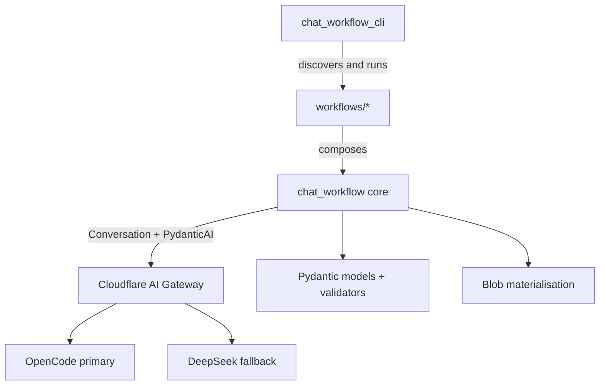

# TECHSPEC — chat-workflow

## Technology choices

| Choice | Why | Requirement |
|---|---|---|
| Python 3.12 | Current house runtime; typing and `match` support | R1–R7 |
| Pydantic v2 | Models are the contract: field descriptions feed the prompt, validators enforce business rules | R1, R3 |
| PydanticAI (`pydantic-ai-slim`) | One model path over an OpenAI-compatible gateway; the answer is a forced tool call, which the endpoint enforces | R5 |
| Typer | CLI discovery is a small surface with good help text | R2 |
| codegen / libcst | Workflow code generation and static verification | R2 |
| Cloudflare AI Gateway | Provider keys stay out of the app; OpenCode → DeepSeek failover; per-repo analytics | R5 |
| uv + ruff + pyrefly | Reproducible installs; lint and type gates that run in seconds | contributor workflow |

No spikes are open. The one deliberate deviation — `unittest` instead of
`pytest` — is recorded in [coding standards](coding-standards.md): the eval
harness needs module-level discovery and a timeout wrapper.

## Architecture

### Layer boundaries (enforced)

`tests/unit/test_architecture.py` asserts, with absolute path globs:

- `chat_workflow/` (the core) may not import `workflows/` or
  `chat_workflow_cli/`.
- `workflows/` may import the core; it may not import the CLI.
- `chat_workflow_cli/` is the composition root and may import both.

The architecture test encodes the layering as designed now; a deliberate
layering change updates the test in the same commit.

## Object model

| Concept | Owner | Contract |
|---|---|---|
| `Config` | `chat_workflow/config.py` | Reads `config.json`; resolves provider/model/api key env/api base |
| `Session` | `chat_workflow/session.py` | One conversation: IO, its own PydanticAI transcript, config, optional parent/children, `instructions`, `active`; `spawn` creates a clean child |
| `SessionComponent` | `chat_workflow/session_component.py` | Runs a session: `greet`, `converse(step)`, `present`, `sign_off`; stateless and usable at any depth |
| `AtomicWorkflow` | `chat_workflow/atomic_workflow.py` | One turn loop over a `Conversation`: intent, turn limit, the last-turn shape |
| `Conversation` | `chat_workflow/conversation.py` | The one model call: transcript, answer tool, transport/unusable/output budgets |
| `CompositeWorkflow` | `chat_workflow/decorators.py` | Calls atomic and composite children with the same `Session` |
| `AgentResponse` / `AgentIntent` | `chat_workflow/models.py` | A discriminated union: continue, success + value, or failure; the answer is a tool call |
| `LLMValidated` | `chat_workflow/mixins.py` | Runs `Validation(...)` rules through the model |
| `BlobSyncMixin` | `chat_workflow/mixins.py` | Materialises annotated fields to files after success |
| `Component` | `workflows/workflow/component.py` | The generated component: a class with a Pydantic model and workflow steps |
| `ComponentSourceCode` | `workflows/workflow/component_source_code.py` | The generated Python source for a component |
| `WorkflowSpec` | `workflows/workflow/workflow_spec.py` | The workflow spec: name, diagram, inputs, outputs, and component specs |
| `ComponentSpec` | `workflows/workflow/component_spec.py` | The component spec: name, purpose, scope, required inputs, type |

`WorkflowSpec` is the **workflow spec**, not a runtime workflow. A runtime workflow
is an atomic or composite workflow step. Further vocabulary:
[domain concepts](reference/domain-concepts.md).

## Documents

A document's home is a property of the document, not of the component, the
process or the person who ran it. Requirements, artefacts, evaluations and
generated code are all documents in one store, distinguished by `type` and
metadata; composition is by reference, with no single top level.

The store is **not in this library**. Persistence is separate libraries
(proposed; not yet implemented): a contract package (`document-store`) and
implementations (`document-store-files` now, `document-store-enterprise` later),
one class per module. The library keeps returning typed results; a failed
semantic rule is a typed `ValidationError` whose message the model continues
from. The record shape, `owning_role`, releases, the local layout and the
deferred interface are in [document store](reference/document-store.md).

## Turn contracts

Nine rules shape a conversation, independent of any one step's prompt:

- **A success says what it did.** `Success` carries `message`, and the session
  speaks it for a chat-on step. A silent completion is not expressible.
- **A step declares the turns its task needs.** `min_turns` is the minimum
  number of model turns before a result is accepted. A gather step that must
  ask or propose first declares two; a success on the first turn is fed back
  as a correction ("do the task's next step"), not accepted as a summary.
- **Changed drafts are shown again; unchanged drafts finish.** A confirmation
  step returns the draft it was given or a corrected one. The framework shows
  a changed draft through the same proposal turn and asks once more; an
  unchanged draft closes, with no second approval.
- **A proposal is one turn.** `Session.propose` says one lead-in, the rendered
  body, and one confirm question. The renderer only renders the body, so a
  deterministic proposal reads as a proposal rather than a field dump.
- **A listening step declares it.** `explore=True` opens with one open
  question and does not propose a structure; a step that derives from
  established inputs leaves it false and proposes from them.
- **The confirmation answers the proposal.** The proposal turn already asked
  the confirm question, so the confirmation step handles the user's answer —
  it corrects a value or confirms, and never re-presents the draft or repeats
  the question the user is answering.
- **A turn is not a question it does not ask.** A success message ends with a
  statement, not a question: asking while claiming the step is done leaves the
  answer unread. A success that ends with `?` is fed back as a correction, and
  a continue that ends with `:` — a promised list it does not give — is
  rejected by the response schema.
- **A turn is not a repeat.** An identical continue message is not a new turn:
  it is fed back with a correction, so a model that did not read the answer it
  was given cannot loop.
- **A result its own rules reject is a turn.** A rejection is about the result,
  not the sample: every retry answers from the same history, so a rule that
  failed for a fact the user has not given cannot be repaired by resampling.
  The rejection is fed back as a correction turn — ask for what is missing —
  and the conversation continues, bounded by `max_turns`. On the last turn the
  run fails rather than asking a question it cannot get answered.

A question the schema already fixes (the three interaction preferences) is
asked by the framework, not left to the model: the answer is a parameter to
the derivation, so the question cannot be skipped or paraphrased away.

## Rendering a typed result

A result record is internal; the proposal is for a person. The record renders
itself — `Renderable.render(context)` in `chat_workflow/rendering.py` — so the
shape and the user's words live together instead of in a parallel formatter.

- **Audience** — always the user. A developer reads the transcript; there is
  no separate developer rendering.
- **Context** — `RenderContext(surface, max_line)`: `chat` or `cli`, and the
  width a line may reach. A record that needs another record's words carries
  them itself: `StructField.field_type_hint` is the domain spec's phrase for
  the type, copied when the structure is derived.
- **Format** — line-oriented plain text. `- ` bullets, no tables, colour,
  HTML, markdown emphasis or headings, or code fences. Long lines wrap at word
  boundaries to `max_line`.
- **Guardrail** — `render_result` validates every block before it reaches the
  transcript and rejects what would display incorrectly: control characters,
  HTML, markup, table pipes, and an unbreakable word wider than the line. It
  does **not** police vocabulary: a renderer must not add schema labels, but a
  user's own domain may legitimately say "consumer" or "format", and censoring
  it would be wrong. A list renders item by item; an empty list renders
  nothing.
- **An empty list is the component's decision.** A step that needs at least
  one item declares `Annotated[list[X], Field(min_length=1)]`; a plain
  `list[X]` allows an empty answer, and the step's success message says why.
  The framework imposes neither rule.

## The model path

There is one path from the library to a model: `Conversation.send()` in
`chat_workflow/conversation.py`. A workflow step, the rule judge, and an eval's
user simulation are all conversations. Nothing else imports a provider SDK.

- **Every step and the rule judge reason.** Their requests carry an explicit
  reasoning effort (`medium` on the OpenAI gateway). The portable `thinking`
  switch alone is not enough for a dynamic gateway model id: PydanticAI has no
  profile for it, so no effort is sent and the provider returns no reasoning.

- The answer travels as a forced `answer` tool call (`ToolOutput(..., strict=True)`).
  `response_format` is not used: the endpoints behind this model accept it and
  ignore it; a tool's schema is enforced on the same route. The wire schema is
  one flat object — `intent`, `message`, optional `result` — because a union
  output type makes PydanticAI nest the answer under `response` while the prompt
  speaks of a top-level `intent`; `as_turn` builds the three turn shapes
  (`continue`, `success`, `failure`) from the flat answer. A `success` carries
  both the words the user reads (`message`) and the typed `result`, so a
  conversational step cannot finish silently.
- The transcript is PydanticAI's message list — thinking, tool calls, tool
  returns, retry prompts and the final answer. `transcript.render` is the one
  projection into the audit view and the user view.
- Retry policy, one class per failure: transport failures are the provider
  SDK's resend; a response with no usable content is resampled invisibly; a
  rejected answer is a visible retry carrying the validator's own complaint; a
  tool failure is a tool result the model adapts to. `max_requests` bounds one
  turn's model steps.
- The last allowed turn offers `FinalResponse` (success or failure, no
  continue), so a step that has run out of turns cannot ask another question.

## Session and prompt architecture

There is one recursive `Session` concept. The top-level conversation and a
meeting spawned inside it are the same class:

- `parent`, `children`, `instructions`, `active` and `spawn` are the tree. A
  child gets the same user and config, a new `SessionLog`, and empty
  `state.messages`; the brief is passed as parameters to the child's step.
- `active` is the one flag. The wrapper sets it while the session runs. The
  greeting condition is `not state.messages`, not a second flag.
- `SessionComponent` is behaviour, not a different session. `converse` sets
  `session.instructions` from its docstring when the session has none, greets
  when the session has no messages, runs the step, then signs off. It does not
  describe the result: a chat-on step's success message is the last thing the
  user reads, and the model writes it. The wrap is explicit in the CLI and the
  eval harness; the decorators never auto-wrap a nested step.
- A step whose result is a derived artifact has three turns: a chat-off step
  derives the value from its inputs; the composite renders that value as the
  proposal turn, ending with one confirm question; a chat-on step reads the
  reply and returns the value. Its success message says what changed, or that
  it is confirmed. This keeps the model from asking the user to define what it
  can derive, and leaves one voice on every turn.
- `greet` and `sign_off` are one-turn text steps (`chat=False`,
  `single_turn=True`): a continue message is the text they produce, so they do
  not ask a user who is not part of that step. They start from an explicit
  first input ("Start the conversation." / "The conversation is over."), not
  the generic opening prompt; a closing that asks a question is replaced with
  a plain statement.

The prompt and history come from the session:

- `system_prompt` = `session.instructions` (the session's overall how) followed
  by the step's prompt: its docstring (procedure), parameters, the
  `## Conversation checklist`, the result model's class-level rules, and the
  user-facing phrase for each internal name.
- A chat-on step is seeded with `session.state.messages` (the PydanticAI
  transcript). A chat-off step starts empty: its parameters are its inputs, and
  replaying the session would invite it to answer the conversation again.
  After the step, only the messages it added are folded back; the step's
  instructions and framework corrections are not session history.
- The checklist is declared on the step (`conversation_validation_rules`,
  defaulting to `DEFAULT_RULES`). It is rendered as `## Conversation checklist`
  and is the list the judge applies.
- `AgentAnswer` is the flat wire model; `AgentResponse` is the internal
  discriminated union (`continue`, `success`, `failure`) that `as_turn` builds
  from it. The answer travels as a forced `answer` tool call, so the schema —
  not a prompt sentence — owns the protocol. No authored prompt says "return
  JSON", "put the text in message", or "never reply with plain text". A
  structurally rejected answer is retried with the validator's own complaint; a
  transport failure is resent; a blank or thinking-only response is resampled
  invisibly. A semantic rule failure is not a retry: see
  [rules and authority](reference/rules-and-authority.md).
- A response that is not an answer — the model's own reasoning, another API's
  object, an empty object — is not replayed as an assistant turn. The answer
  schema and the answer tool still enforce the envelope; a truncated or
  non-answer sample is retried as a fresh provider sample.

## Data flow

1. The CLI discovers workflow entrypoints, constructs a root `Session`, and
   runs the top-level step through `SessionComponent.converse`.
2. An atomic workflow step assembles `session.instructions` + its own prompt,
   seeds a `Conversation` with the session transcript, and sends it through
   PydanticAI.
3. `model_provider.build_model()` resolves the credential from `api_key_env`
   and points PydanticAI at `api_base` (or `OPENAI_BASE_URL`).
4. The model returns a call to the `answer` tool; the discriminated
   `AgentResponse` validates it. A `success` result runs the business-rule
   validator and the blob mixin, then returns the typed value; a rejected
   answer is retried with the validator's complaint.
5. A composite workflow step loops over atomic children, feeds gaps back into
   refinement steps, and returns the final typed result. Its children share the
   session and its conversation; a child session created with `spawn` gets a
   clean context.

## Decisions

| Decision | Alternatives | Requirement |
|---|---|---|
| Cloudflare AI Gateway is the eval/CI provider | Direct OpenRouter/OpenCode keys per repo | R5: one credential, failover, analytics |
- **A step's tools** (`conversation.py`, `atomic_workflow_config.py`): plain
  functions passed as `tools=[...]`; the signature is the schema the model is
  given, and `deps` is what a tool receives from the caller. A tool that raises
  becomes a `ToolFailed` result the model reads and adapts to; a malformed call
  is a retried tool return under the answer's budget.
| The answer is a forced `answer` tool call | `response_format` / JSON-mode prompting | The endpoints accept `response_format` and ignore it; a tool's schema is enforced on the same route |
| Agent sampling uses the configured temperature | Pinning to 0 for determinism | The model is stochastic; the eval must resemble production, and 0 is not deterministic anyway |
| `unittest` for the eval harness | pytest | Evals need module discovery and a wall-clock timeout wrapper |
| Pyrefly with a both-direction baseline lock | basedpyright, mypy | A large existing codebase; the lock catches new and stale diagnostics |
| No server or database | Web service | The library runs in the caller's process |

## Security and operations

- Secrets live in the environment / untracked `.env`; the committed
  `.env.example` documents the two variables (`OPENAI_BASE_URL`,
  `OPENAI_API_KEY`).
- CI passes the gateway token only to the eval step, and skips that step for
  dependabot and forked PRs (no secrets, so it could only fail).
- Evals run under `scripts/run_with_timeout.py`; transcripts are uploaded
  even when the run fails.
