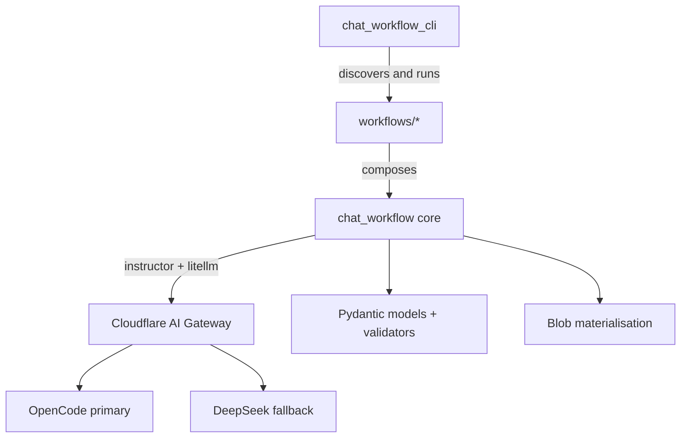

# TECHSPEC — chat-workflow

## Technology choices

| Choice | Why | Requirement |
|---|---|---|
| Python 3.12 | Current house runtime; typing and `match` support | R1–R7 |
| Pydantic v2 | Models are the contract: field descriptions feed the prompt, validators enforce business rules | R1, R3 |
| Instructor + litellm | One structured-output client over many providers; JSON mode keeps models without tool calling usable | R5 |
| Typer | CLI discovery is a small surface with good help text | R2 |
| codegen / libcst | Workflow code generation and static verification | R2 |
| Cloudflare AI Gateway | Provider keys stay out of the app; OpenCode → DeepSeek failover; per-repo analytics | R5 |
| uv + ruff + pyrefly | Reproducible installs; lint and type gates that run in seconds | contributor workflow |

No spikes are open. The one deliberate deviation — `unittest` instead of
`pytest` — is recorded in [coding standards](coding-standards.md): the eval
harness needs module-level discovery and a timeout wrapper.

## Architecture

### Layer boundaries (enforced)

`tests/unit/test_architecture.py` asserts, with absolute path globs:

- `chat_workflow/` (the core) may not import `workflows/` or
  `chat_workflow_cli/`.
- `workflows/` may import the core; it may not import the CLI.
- `chat_workflow_cli/` is the composition root and may import both.

The architecture test encodes the layering as designed now; a deliberate
layering change updates the test in the same commit.

## Object model

| Concept | Owner | Contract |
|---|---|---|
| `Config` | `chat_workflow/config.py` | Reads `config.json`; resolves the active preset into provider/model/api key env/api base |
| `Session` | `chat_workflow/session.py` | IO + `SessionLog` + config for one CLI invocation |
| `AtomicWorkflow` | `chat_workflow/atomic_workflow.py` | Drives one turn loop until success, failure, or the turn limit |
| `CompositeWorkflow` | `chat_workflow/decorators.py` | Calls atomic and composite children with the same `Session` |
| `AgentResponse` / `AgentIntent` | `chat_workflow/models.py` | The structured turn result: continue, success + value, or failure |
| `LLMValidated` | `chat_workflow/mixins.py` | Runs `Validation(...)` rules through the model |
| `BlobSyncMixin` | `chat_workflow/mixins.py` | Materialises annotated fields to files after success |

Further vocabulary: [domain concepts](reference/domain-concepts.md).

## Data flow

1. The CLI discovers workflow entrypoints and constructs a `Session`.
2. An atomic workflow sends the accumulated messages plus the response
   model to `get_client()`.
3. `get_client()` resolves the credential from `api_key_env`, points litellm
   at `api_base` (or `OPENAI_BASE_URL`), and picks Instructor's JSON or
   TOOLS mode from `model_supports_tools`.
4. The model returns an `AgentResponse`; a `success` intent runs the
   business-rule validator and the blob mixin, then returns the typed value.
5. A composite workflow loops over atomic children, feeds gaps back into
   refinement steps, and returns the final typed result.

## Decisions

| Decision | Alternatives | Requirement |
|---|---|---|
| Cloudflare AI Gateway is the eval/CI provider | Direct OpenRouter/OpenCode keys per repo | R5: one credential, failover, analytics |
| Instructor JSON mode by default | Forced tool calling | R5: DeepSeek V4 thinking mode rejects forced `tool_choice` |
| `unittest` for the eval harness | pytest | Evals need module discovery and a wall-clock timeout wrapper |
| Pyrefly with a both-direction baseline lock | basedpyright, mypy | A large existing codebase; the lock catches new and stale diagnostics |
| No server or database | Web service | The library runs in the caller's process |

## Security and operations

- Secrets live in the environment / untracked `.env`; the committed
  `.env.example` documents the two variables (`OPENAI_BASE_URL`,
  `OPENAI_API_KEY`).
- CI passes the gateway token only to the eval step, and skips that step for
  dependabot and forked PRs (no secrets, so it could only fail).
- Evals run under `scripts/run_with_timeout.py`; transcripts are uploaded
  even when the run fails.
